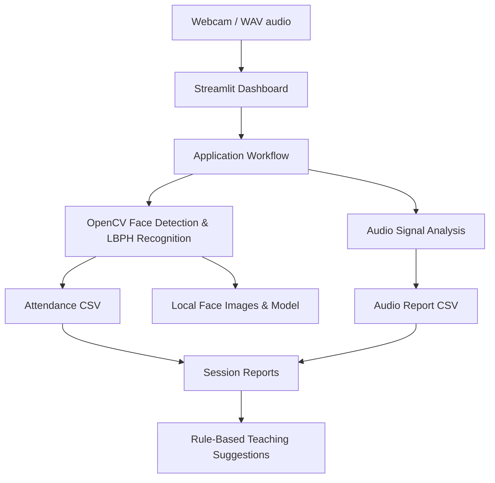

# Multimodal Attendance & Engagement Agent

An **offline-first classroom analytics prototype** built with Python, Streamlit, OpenCV, NumPy, Pandas, and SoundFile. It demonstrates local face-based attendance, basic audio activity analysis, CSV reporting, and rule-based teaching prompts.

> **Project status:** Educational MVP. It is not a validated engagement measurement system or a production attendance product. Recognition and analytics must be reviewed by a human.

## Features

- Student registration with student ID and name
- Local enrollment of face photos
- Local LBPH face model training using OpenCV-contrib
- Live webcam face recognition and attendance logging
- WAV audio activity analysis (relative sound activity and low-activity intervals)
- Rule-based teaching reflection prompts
- Attendance and audio report tables with CSV export
- Local file storage; no cloud service required for the current MVP

## Architecture



## Technology stack

- **Python 3.10–3.11**
- **Streamlit** — web dashboard
- **OpenCV-contrib** — face detection and LBPH recognition
- **NumPy / SoundFile** — basic audio signal analysis
- **Pandas** — tabular data and CSV reports
- **Pillow** — image upload handling

## Run locally

### Windows

1. Install Python 3.11 and select **Add Python to PATH** during setup.
2. Download and extract this repository.
3. Open PowerShell or Command Prompt in the project directory.
4. Create and activate a virtual environment:

   ```powershell
   py -3.11 -m venv .venv
   .\.venv\Scripts\Activate.ps1
   ```

   If PowerShell blocks activation, use Command Prompt and run `.venv\Scripts\activate.bat`.

5. Install packages:

   ```bash
   python -m pip install --upgrade pip
   pip install -r requirements.txt
   ```

6. Start the app:

   ```bash
   streamlit run app.py
   ```

7. Open the local address printed in the terminal, usually `http://localhost:8501`.

### macOS / Linux

```bash
python3 -m venv .venv
source .venv/bin/activate
python -m pip install --upgrade pip
pip install -r requirements.txt
streamlit run app.py
```

## First-time usage

1. Open **Student Enrollment** and register a test student.
2. Upload a few clear, front-facing photos for that student. Use only images collected with informed consent.
3. Select **Train / retrain face model**.
4. Open **Live Attendance**, allow camera access, and run a short scan.
5. Open **Audio Analysis** and upload a WAV file.
6. Open **Session Report** to inspect and download CSV records.

## Local data files

The app creates a `data/` directory at runtime. It may contain:

- `students.csv` — student IDs and names
- `faces/` — enrolled face crops
- `lbph_model.yml` and `labels.csv` — trained model and label mapping
- `attendance.csv` — attendance records
- `audio_reports.csv` — audio analysis summaries

**Never commit real student data, face images, audio recordings, or generated model files to a public GitHub repository.** The `.gitignore` excludes runtime data by default.

## Limitations and roadmap

The current MVP does not yet implement all advanced goals in the proposed project specification. In particular:

- Recorded-video processing and multi-object tracking are not included in this MVP.
- Head-pose estimation is not implemented; face detection is not a reliable proxy for attention.
- Audio analysis estimates relative loudness/activity, not accurate speech recognition or speaker turns.
- Multimodal fusion is not yet a validated model; no scientific engagement score is claimed.
- The teaching suggestion module is rule-based, not a connected generative-AI agent.
- Flask API separation, authentication, role-based access, and production deployment are not included.

These are appropriate future enhancements for a staged college project. Report measured results only after testing with consented data and a documented evaluation procedure.

## Privacy, ethics, and responsible use

- Obtain informed consent before collecting face photos, webcam video, or classroom audio.
- Offer a non-biometric attendance option.
- Keep processing local where practical and limit access to records.
- Define retention/deletion rules and delete test data when finished.
- Manually verify attendance; face recognition can make mistakes.
- Do not use audio volume, head movement, or inactivity to grade, punish, or label individual students. These signals are context-dependent and cannot establish attention or learning.
- Do not upload identifiable classroom data to external AI services without appropriate authorization.

## Repository structure

```text
multimodal-attendance-agent/
├── app.py
├── face_utils.py
├── audio_analysis.py
├── requirements.txt
├── run_windows.bat
├── README.md
├── LICENSE
├── .gitignore
└── data/                 # created/used locally; ignored by Git
```

## License

This project is provided under the MIT License. See `LICENSE`.
